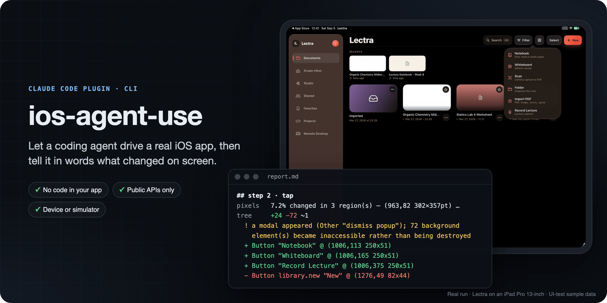
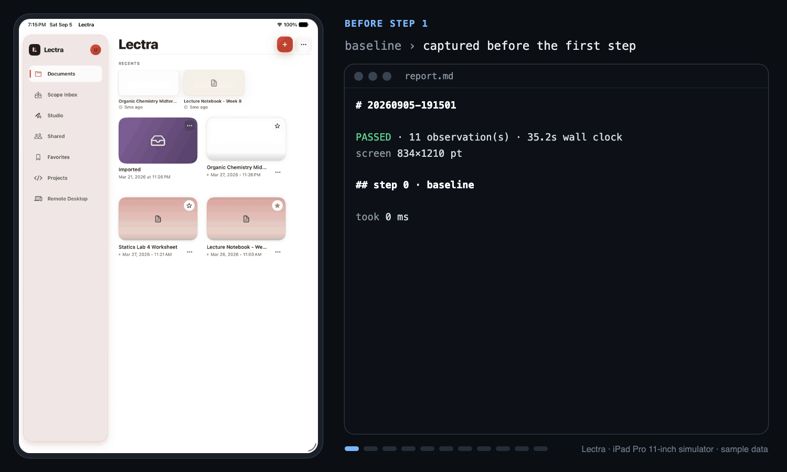
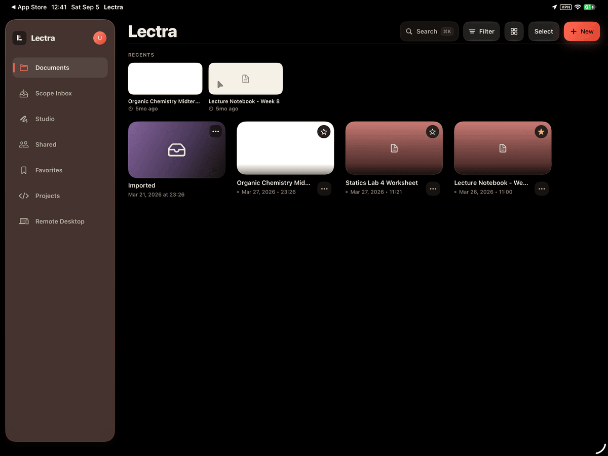
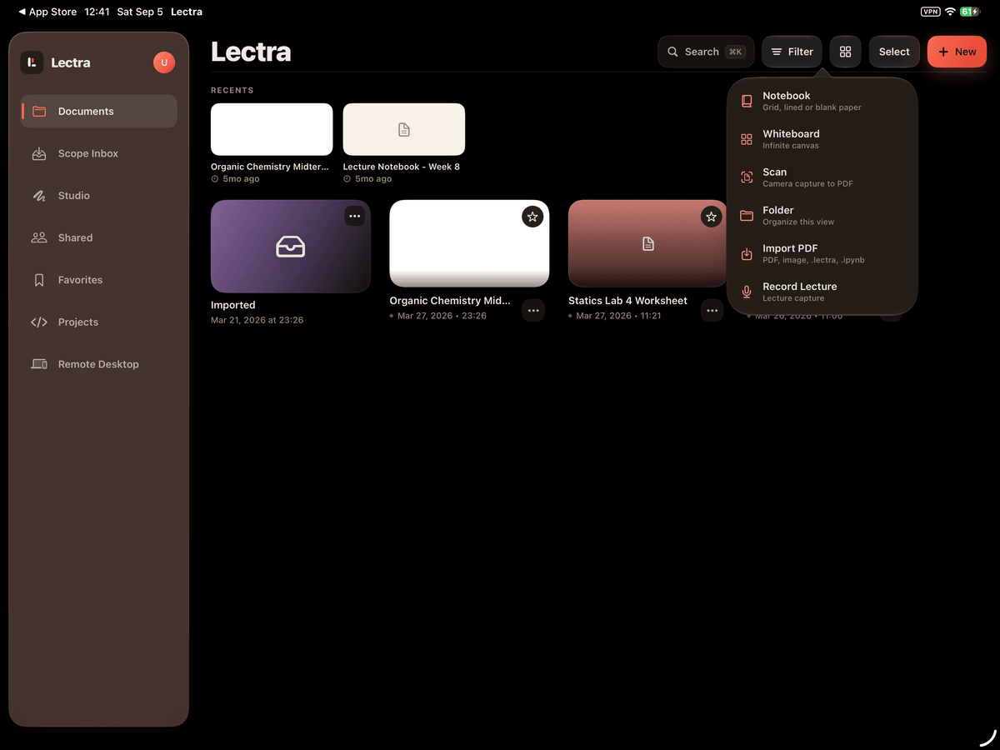
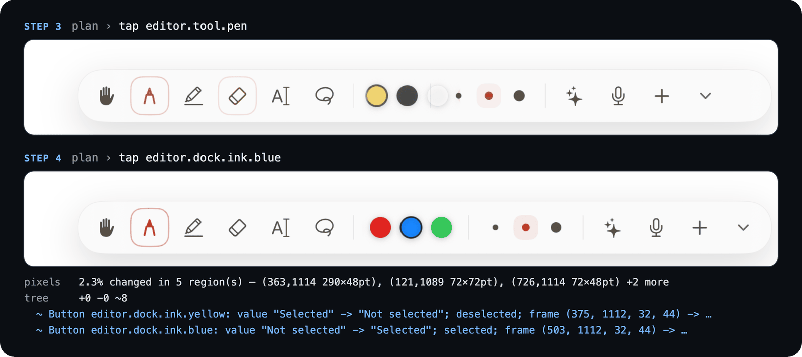
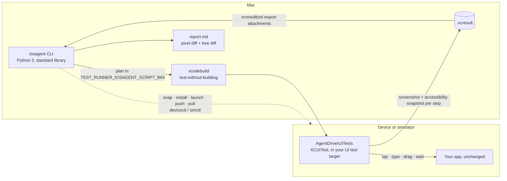

<p align="center">
  
</p>

<p align="center">
  <b>Let a coding agent drive a real iOS app on a device or simulator, then tell it in words what changed.</b><br>
  Each step comes back as a screenshot plus a diff of the accessibility tree, so the agent knows what appeared, what it is called, and what to tap next.
</p>

<p align="center">
  
  
  
  
  
  
  
</p>

<p align="center">
  <a href="#see-it-work">Demo</a> ·
  <a href="#how-it-works">How it works</a> ·
  <a href="#install">Install</a> ·
  <a href="#the-loop">The loop</a> ·
  <a href="#design--build--check">Design check</a> ·
  <a href="#architecture">Architecture</a> ·
  <a href="#what-it-cannot-do">Limitations</a>
</p>

> [!NOTE]
> ios-agent-use is version 0.1.0, built by one developer while working on Lectra, an iPad app by the same author. Every run in this README comes from Lectra in its UI-test mode, which loads sample documents. Read [docs/LIMITATIONS.md](docs/LIMITATIONS.md) before you rely on it.

## Why

Agents can already write Swift. What they usually can't do is *check*: build the change, open the app, tap the thing, and see whether the editor actually opened. ios-agent-use closes that loop with only the tools Xcode already ships.

A screenshot tells an agent that *something* changed. The report tells it which elements appeared, where they are, and what they are called, so it can decide what to tap next instead of guessing at pixels.

## See it work

<p align="center">
  
</p>

<sub>Built from the saved artifacts of one real 11-step <code>iosagent run</code> against Lectra on the iPad Pro 11-inch (M5) simulator. Each frame pairs a step's captured screenshot with that step's section of <code>report.md</code>. Steps 5, 6, 7, and 9 are left out, ⋮ marks report lines that were cut, long lines are clipped, and the red outlines mark the changed regions that the report lists by coordinates, except full-screen ones.</sub>

## How it works

<table>
  <tr>
    <td width="50%"></td>
    <td width="50%"></td>
  </tr>
  <tr>
    <td valign="top"><b>1. Send a batch of steps.</b> <code>iosagent run --mode launch 'wait 1' 'tap library.new'</code> runs every step in one <code>xcodebuild test-without-building</code>. The driver in your UI test target performs each step and attaches a screenshot and an accessibility snapshot after it.</td>
    <td valign="top"><b>2. Read what changed.</b> The host diffs each step against the one before. For this tap, the report names the six new menu buttons and notes that a modal now covers 72 background elements, instead of reporting 72 elements as destroyed.</td>
  </tr>
</table>

<sub>Both screenshots are from the run shown in the following output, on a physical iPad Pro 13-inch.</sub>

```console
$ iosagent run --mode launch --label orient 'wait 1' 'tap library.new'
driving device:iPad Pro 13-inch — 2 step(s)

report: ~/.iosagent/runs/lectra-ios/20260905-124055-orient/report.md
PASSED in 13s (3 observations)
```

`run` prints the path to `report.md`. That report, not the screenshot, is the point. An excerpt from this run:

```markdown
## step 2 · tap

took 1942 ms
pixels   7.2% changed in 3 region(s) — (963,82 302×357pt), (467,165 55×55pt), (1238,0 27×27pt)
tree     +24 −72 ~1
  ! a modal appeared (Other "dismiss popup"); 72 background element(s) became inaccessible rather than being destroyed
  + Other PopoverDismissRegion "dismiss popup" @ (0,0 1376x1032)
  + Button "Folder" @ (1006,270 250x51)
  + Button "Import PDF" @ (1006,323 250x51)
  + Button "Notebook" @ (1006,113 250x51)
  + Button "Record Lecture" @ (1006,375 250x51)
  + Button "Scan" @ (1006,218 250x51)
  + Button "Whiteboard" @ (1006,165 250x51)
  + … and 12 more added
  - Button library.new "New" @ (1276,49 82x44)
  - … and 60 more removed

## what is tappable now

- `Notebook` — Button "Notebook"
- `Whiteboard` — Button "Whiteboard"
- `Scan` — Button "Scan"
- `Folder` — Button "Folder"
- `Import PDF` — Button "Import PDF"
- `Record Lecture` — Button "Record Lecture"
```

Every coordinate is in points, the same space as the accessibility frames, so a changed area and the element that changed line up. The final list gives the agent identifiers for its next batch.

### The tree says what the pixels can't

<p align="center">
  
</p>

<sub>Crops of the tool dock from steps 3 and 4 of the simulator run in the demo, with the step 4 lines from its report (long lines clipped).</sub>

Tapping the blue ink changed 2.3% of the screen, and the swatches also moved. The pixel diff only says that the dock changed. The tree diff says what changed: `editor.dock.ink.blue` went from `"Not selected"` to `"Selected"`, and yellow went the other way.

## What it does not require

- **No code in your app.** Nothing is imported, linked, or `#if DEBUG`-ed into the binary you ship. One file goes into your *UI test* target, and it skips itself unless `iosagent` is driving it.
- **No private APIs.** It uses public XCUITest, `devicectl`, `simctl`, and `xcresulttool`.
- **No daemon, server, port forwarding, Appium, `bun`, or `pip`.** It needs Python 3 with the standard library, and Xcode.

## Install

### As a Claude Code plugin (recommended)

```
/plugin marketplace add NoelSason/ios-agent-use
/plugin install ios-agent-use@ios-agent-use
```

The plugin registers the `ios-agent-use` skill, so an agent knows when to reach for the tool and how to read what comes back. The CLI ships with it at `${CLAUDE_PLUGIN_ROOT}/bin/iosagent`.

### As a CLI

```bash
curl -fsSL https://raw.githubusercontent.com/NoelSason/ios-agent-use/main/install.sh | bash
```

The installer clones the repo to `~/.ios-agent-use`, links `iosagent` into `~/.local/bin`, and registers the skill if `~/.claude` exists. To clone it yourself instead:

```bash
git clone https://github.com/NoelSason/ios-agent-use.git
cd ios-agent-use && ./install.sh
```

### Then, once per project

```bash
cd your-app-project
iosagent init                     # writes .iosagent.json
iosagent driver YourAppUITests/   # copies the driver into your UI test target
iosagent doctor
```

`doctor` checks the toolchain, the project, and which devices are reachable, and tells you what is missing. You need macOS, Xcode, and Python 3. There is nothing to `pip install` and nothing to keep running. [docs/INTEGRATING.md](docs/INTEGRATING.md) covers the config keys, seeding app state, build wrappers, and signing for device runs.

## The loop

```bash
iosagent build                       # app + test bundle
iosagent run 'tap library.new' 'waitFor editor.canvas' 'drag @.3,.4 @.7,.6'
iosagent snap                        # a screenshot only, ~1 s, no test run
iosagent diff <stepA> <stepB>
```

One `run` is one `xcodebuild test-without-building`. On a device it costs about 13-20 s however many steps it holds, so put twenty steps in a batch, not one. Between batches the app is activated rather than relaunched, so state survives and a sequence of batches behaves like one session. [docs/ACTIONS.md](docs/ACTIONS.md) lists every action, selector, and the plan-file format.

## Design → build → check

To compare a design file against what the device actually renders, run:

```bash
iosagent design mock.dc.html --out reference.png    # headless Chrome
iosagent run 'tap library.new'                       # build your screen, then look
iosagent compare mock.dc.html ~/.iosagent/runs/app/latest/steps/002
```

`compare` produces a side-by-side composite at matched scale, a dominant-color table for both sides, and a check of every string in the design against the accessibility labels on the built screen. It checks color and text objectively. It leaves layout to your eyes, because a mockup and a real screen legitimately differ in fonts, insets, and safe areas. `design` needs Google Chrome or Chromium.

## Commands

| | |
|---|---|
| `init` `doctor` `driver` `targets` | set up, verify, discover |
| `build` `install` `launch` `terminate` | lifecycle |
| `run` `snap` `diff` | the loop |
| `design` `compare` | design-to-screen |
| `open` `push` `pull` `logs` | deep links, app-container files, logs |
| `clean` | prune old run artifacts |

Global flags go before the command: `-t sim` picks a target from `.iosagent.json`, and `-C <dir>` sets the project directory.

## Design decisions

- **A batch, not a live session.** A long-lived on-device server would cut per-action latency, but it needs a daemon, a transport that survives Xcode's tunnel dropping when idle, and private APIs or a second signed bundle. Instead, `xcodebuild` forwards the plan in a `TEST_RUNNER_` environment variable, and results come back as `XCTAttachment`s in the result bundle. Nothing has to stay alive or be cleaned up if a run dies.
- **The tree diff matters more than the image.** Elements are matched by identifier, then label, then tree position, so an element that moves is reported as moved. Elements with no identifier and no label are counted, not listed.
- **A modal is named as a modal.** When a popover appears, everything behind it leaves the accessibility tree. The diff detects the covering element and says so instead of listing dozens of removals.
- **Capture the whole screen, then rotate on the host.** `XCUIScreen` captures popovers, sheets, and alerts that `app.screenshot()` omits, but it returns the native portrait framebuffer. The driver reports the device orientation, and the host rotates the image with `sips`.
- **A low pixel threshold.** Both images are lossless captures from the same renderer, so a 16×16 tile is marked changed when more than 2% of its sampled pixels differ by more than 6 levels. A mean-based test misses a whole popover on a dark interface.
- **DerivedData it won't leak.** Without a build wrapper, `iosagent` reuses one DerivedData folder and refuses paths under `/tmp` or inside iCloud- or Dropbox-synced folders. Fresh `/tmp` folders per run once piled up to 215 GB, and synced folders break codesigning during `test` only.

## Architecture



| Path | What it holds |
|---|---|
| [`bin/iosagent`](bin/iosagent) | Entry point |
| [`src/iosagent/`](src/iosagent/) | The CLI: builds, device and simulator control, the batch runner, the pixel diff and PNG codec, the tree diff, the report, and design rendering |
| [`driver/AgentDriverUITests.swift`](driver/AgentDriverUITests.swift) | The XCUITest driver that `iosagent driver` copies into your UI test target |
| [`skills/ios-agent-use/`](skills/ios-agent-use/) | The Claude Code skill and its references |
| [`.claude-plugin/marketplace.json`](.claude-plugin/marketplace.json) | Plugin marketplace manifest |
| [`docs/`](docs/) | [Architecture](docs/ARCHITECTURE.md), [actions](docs/ACTIONS.md), [integrating](docs/INTEGRATING.md), [limitations](docs/LIMITATIONS.md), [prior art](docs/PRIOR-ART.md) |
| [`examples/lectra/`](examples/lectra/) | A real configuration and a seven-step plan for Lectra |
| [`tests/`](tests/) | Unit tests |

## Tests

```bash
PYTHONPATH=src python3 -m unittest discover -s tests
```

The suite runs 41 unit tests on config loading, the DerivedData guards, the step shorthand, the pixel diff, PNG decoding and rotation, and the tree diff. It does not drive a device. The runs shown in this README are the end-to-end check, on one physical iPad and one iPad simulator.

## What it cannot do

Read [docs/LIMITATIONS.md](docs/LIMITATIONS.md) before you rely on it. In short:

- **No Apple Pencil.** No public API synthesizes a Pencil touch, pressure, or tilt. Every input is a finger.
- **No curved strokes.** A drag is a straight line, and a polyline is separate gestures with a lift between each.
- **About 13-20 s per batch on a device.** Launching the test runner dominates the cost, not the steps.
- **The device must be unlocked**, and only one session runs at a time.
- **Dense accessibility trees are slow**, and elements with no identifier or label are counted but not named.
- **No audio, memory pressure, thermal state, or camera.**
- **`compare` doesn't check layout**, only color and text.

## License

MIT, © 2026 Noel Sason. See [docs/PRIOR-ART.md](docs/PRIOR-ART.md) for related work: gstack `ios-qa`, WebDriverAgent and Appium, KIF, and `idb`.
